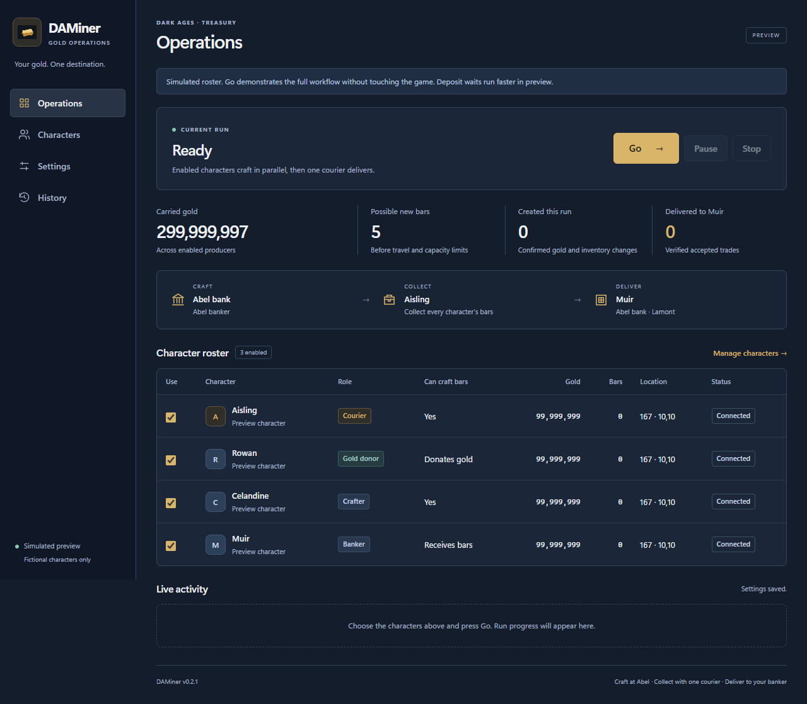
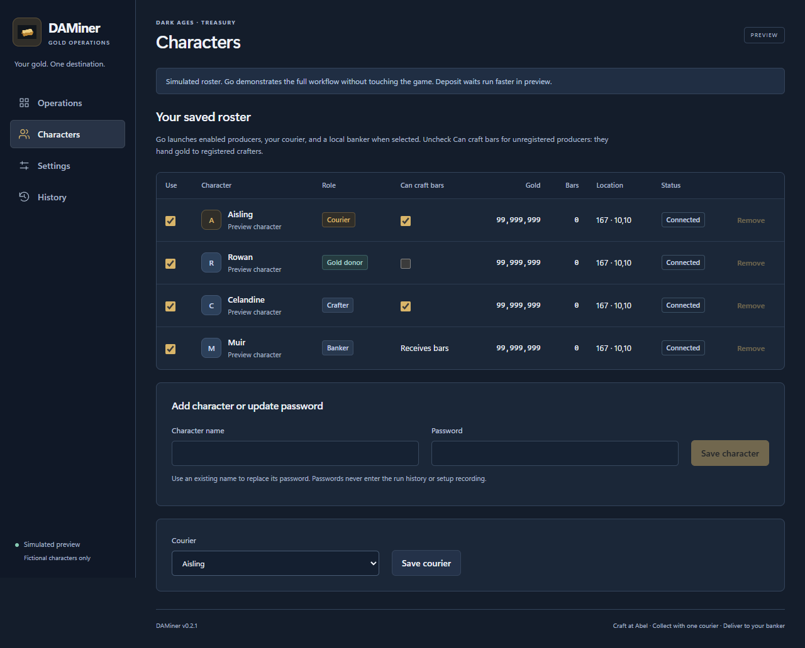
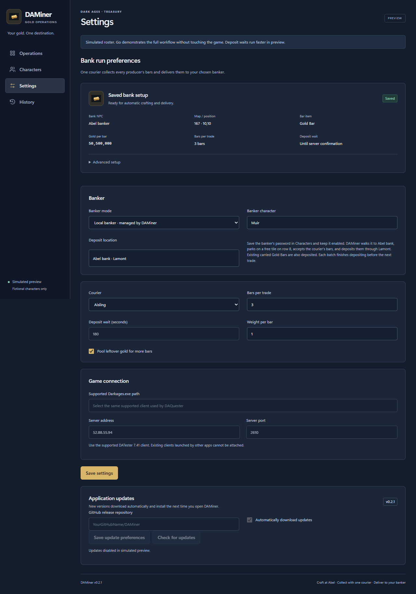
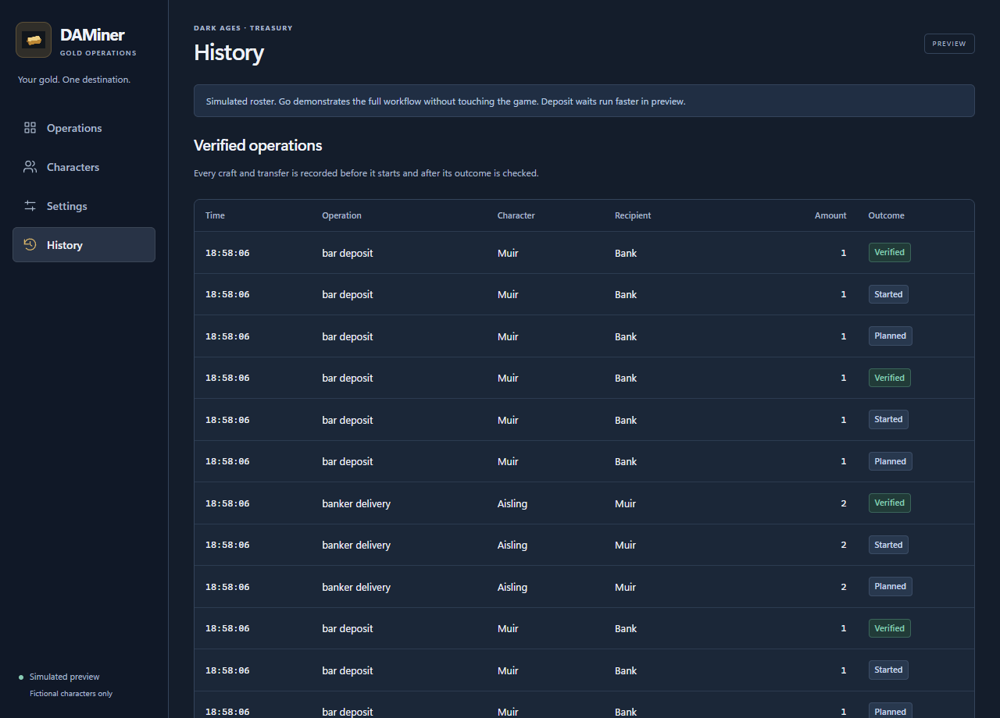

# DAMiner

[](https://github.com/BuildWithRaymond/DAMiner/actions/workflows/ci.yml)
[](LICENSE)

Windows desktop automation for turning carried **Dark Ages gold into Gold Bars**, collecting them through one courier, and delivering them to your banker.

DAMiner runs enabled characters concurrently, lets unregistered characters donate gold to registered crafters, and checks server evidence before recording a craft or transfer as successful. Its MAUI Blazor interface shares the same workflow with a simulation-only browser preview.

## Screenshots

Simulation preview with fictional characters and original public artwork. The Windows app shares this interface.



<details>
<summary>Character roster, banker settings, and verified history</summary>

### Character roster

Enable characters and choose which accounts can craft bars.



### Banker settings

A local banker receives batches and deposits through Lamont at Abel bank.



### Verified history

Crafts, trades, and deposits retain their planned, started, and verified outcomes.



</details>

## Download and start

Get the **portable ZIP** or **Windows installer** from [Releases](https://github.com/BuildWithRaymond/DAMiner/releases). Extract the entire ZIP before opening `DAMiner.exe`. Windows 10/11 x64 and WebView2 are required.

1. Save characters in **Characters**. Disable **Can craft bars** for unregistered accounts.
2. Choose a courier and banker in **Settings**. A **local banker** walks to Abel bank and deposits through Lamont. An **external banker** is already running elsewhere and handles its own acceptance and deposits.
3. Use **Record setup** once to demonstrate a bar purchase and completed sample trade. Save the verified setup.
4. Click **Go**. The courier collects everyone's bars and delivers verified batches.

Fresh profiles use Local mode with an empty banker name. The repository contains no saved accounts, passwords, or personal banker configuration. Passwords are encrypted for your Windows user and kept outside the installation.

[Complete operating guide](docs/usage.md) ? [Automatic updates](docs/auto-updates.md)

## Build from source

Install the [.NET 10 SDK](https://dotnet.microsoft.com/download/dotnet/10.0), Windows MAUI workload, and WebView2:

```powershell
dotnet workload install maui-windows
./tools/Build.ps1
```

The script runs simulated tests and builds the Windows app. For a game-free preview:

```powershell
dotnet run --project src/DAGoldManager.Preview -c Release --urls http://127.0.0.1:5186
```

Open `http://127.0.0.1:5186`. The Windows executable also supports `--demo`. Source project names and the original data directory retain `DAGoldManager` for compatibility; the product is DAMiner.

## Project layout

| Path | Responsibility |
| --- | --- |
| `src/DAGoldManager.Core` | Pure planning, run coordination, and simulator |
| `src/DAGoldManager.Game` | Client launch, walking, recording, and verified operations |
| `src/DAGoldManager.Storage` | SQLite settings/history and Windows password encryption |
| `src/DAGoldManager.UI` | Shared Razor components and dashboard model |
| `src/DAGoldManager.Desktop` | Windows host and update startup |
| `src/DAGoldManager.Preview` | Browser host using fictional characters |
| `src/DAGoldManager.Updates` | Release checks, downloads, and update preferences |
| `tests` / `tools` | Simulated tests, builds, packaging, and browser checks |
| `vendor/DAQuester` | Preserved upstream engine sources and notices |

Start with [the code tour](docs/code-tour.md), then [the developer guide](docs/development.md). Comments explain ownership, evidence, concurrency, and recovery beside the code implementing them.

## Contribute

Bug reports, documentation improvements, and focused pull requests are welcome. Read [CONTRIBUTING.md](CONTRIBUTING.md) for setup, validation, coding style, and review expectations. Transaction changes must preserve fresh evidence and must never retry an ambiguous operation. Build and test with simulated characters; live recording and automation remain user actions.

Use [Issues](https://github.com/BuildWithRaymond/DAMiner/issues) for bugs and proposals. See [security reporting](.github/SECURITY.md) for sensitive reports and [the code of conduct](CODE_OF_CONDUCT.md) for community expectations.

## License and assets

DAMiner's original application source and generated artwork are [MIT licensed](LICENSE). Vendored components retain their own notices; see [THIRD_PARTY_NOTICES.md](THIRD_PARTY_NOTICES.md).

Game clients and game artwork are not included. Builds generate an original gold-bar icon when local icon files are absent. Existing local artwork is preserved and ignored by Git. Route/walkability metadata describes navigation and contains no rendered game maps. DAMiner is an independent community project, not endorsed by the game's owners.
